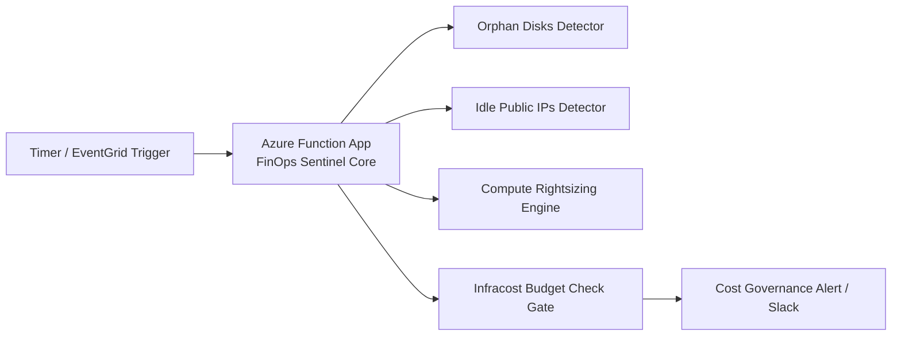

# 💰 Cloud FinOps Sentinel

Serverless cloud financial management bot automating multi-cloud waste elimination, resource rightsizing, and predictive CI/CD budget gating.

---

## 🧭 Architecture

---

## ⚡ Key Modules & Engineering Patterns

* **Waste Detectors ([`analyzers/waste_detector.py`](./analyzers/waste_detector.py)):** Scans subscriptions for unattached managed disks, obsolete VM snapshots, and idle public IPs.
* **Rightsizing Engine ([`analyzers/rightsizing.py`](./analyzers/rightsizing.py)):** Evaluates CPU/memory p95 percentiles over rolling 14-day windows to recommend SKU downsizing.
* **Terraform Serverless Platform ([`terraform/`](./terraform/)):**
  * Modular Azure Functions, Storage Account, and App Service Plan provisioning.
  * `for_each`: Multi-scan schedule rules and severity levels.
  * Conditional iteration: Infracost CI/CD gate toggles and auto-remediation triggers.

---

## 👤 Author

**Rishikesh Sharma**  
Senior DevSecOps Engineer & Cloud Solutions Architect  
[GitHub Profile](https://github.com/RisikeshSharma) · [LinkedIn](https://linkedin.com)
